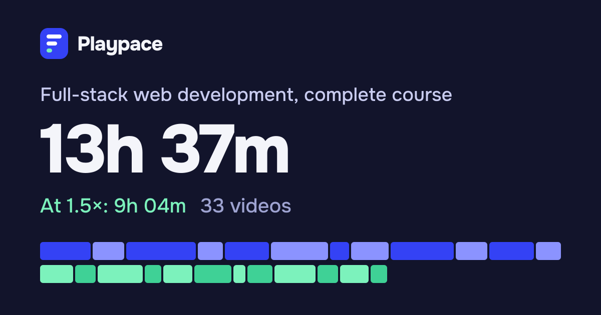

# Playpace

**Find out how long any YouTube playlist is, at every playback speed.** Paste a playlist, video or channel link and Playpace adds up every video, shows the time at 1.25×, 1.5×, 2× or any speed you type, splits it into days that fit your schedule and keeps track of what you've watched. Free, no sign-up, in 12 languages.

**Live:** https://getplaypace.vercel.app



## What it does

- **Total length of a playlist, channel or video**, with private, deleted and live videos listed and left out of the total.
- **Several lists at once.** Paste up to ten links, one per line, and get one numbered total.
- **Part of a list.** Count a range (videos 10 to 40) or everything from one video to the end. Links copied while watching (`&index=12`) start there automatically.
- **Any speed.** Every common speed side by side with the time saved, plus any custom speed from 0.25× to 16×.
- **A timeline strip** that draws every video as a block sized by its length and shrinks as you speed up, so the time saved is visible.
- **Daily plan.** Pick minutes per day, skip weekends, see each day's videos and your finish date, or pick a deadline and get minutes per day. Export the plan as an `.ics` file for Google Calendar, Apple Calendar or Outlook.
- **Watched list.** Tick videos as you go; the time left updates and the marks stay in your browser.
- **Share and export.** Copy a link that reopens the current result, share buttons for WhatsApp, X, Facebook, Telegram, Reddit, LinkedIn and email, a preview image with the result's own numbers, and a CSV of every video.
- **Recent lookups**, dark mode (follows your device or your choice) and a separate **video speed calculator** page.
- **12 languages:** English, Spanish, Portuguese, French, German, Russian, Turkish, Indonesian, Hindi, Urdu, Arabic and Japanese, with right-to-left layout for Urdu and Arabic.

## How it works

The browser sends the link to `/api/playlist`, which reads the list with the YouTube Data API v3 and streams newline-delimited JSON back: the list's details first, then progress while videos load, then every video with its length. A 5,000-video playlist takes about 20 seconds the first time and shows live progress.

- **Quota-friendly.** One request per 50 videos for the list and one per 50 for durations (about 200 quota units for a 5,000-video playlist). Finished lists are kept for two hours in Vercel's Runtime Cache, and two people asking for the same list at once share one set of requests.
- **Protected.** Fresh lookups are charged by their estimated quota cost: each address gets 600 units per 10 minutes and each server instance 9,000 units a day, so scripts can't burn the daily quota. Responses ask YouTube only for the fields Playpace uses. The API key never leaves the server.
- **Everything else runs in the browser**: speeds, ranges, the plan, the watched list and exports.

## Stack

- Next.js 16 (App Router), React 19, TypeScript in strict mode
- Hand-written CSS with design tokens, light and dark themes, logical properties for RTL
- Onest for Latin and Cyrillic; self-hosted Noto Nastaliq Urdu, Noto Sans Arabic and Noto Sans Devanagari, preloaded only on their language's pages
- Vercel Runtime Cache (`@vercel/functions`), `next/og` for share images
- Vitest, Playwright and axe-core; GitHub Actions CI

## SEO and quality

- Every page exists in 12 languages with `hreflang` alternates, `x-default`, a canonical address and its own Open Graph image; English lives at the root and other languages under `/es`, `/ur`, …
- `sitemap.xml` (36 pages), `robots.txt`, web app manifest, JSON-LD (`WebSite`, `WebApplication`, `FAQPage`, `BreadcrumbList`)
- Strict Content Security Policy with a fresh nonce per request, HSTS, `X-Frame-Options: DENY`, no `X-Powered-By`
- WCAG 2.1 AA checked with axe in light and dark mode, keyboard-friendly, works with reduced motion
- Lighthouse on a local production build: desktop 100 in all four categories; mobile performance 91 to 98, accessibility, best practices and SEO 100

## Run it locally

Requires Node.js 20.9 or newer.

```bash
npm install
cp .env.example .env.local   # add YOUTUBE_API_KEY, or use sample data:
PLAYPACE_SAMPLE_DATA=1 npm run dev
```

Open http://localhost:3000. With `PLAYPACE_SAMPLE_DATA=1` the site serves built-in sample playlists instead of calling YouTube, so it works offline and in tests.

### Environment variables

| Name | Required | What it does |
|---|---|---|
| `YOUTUBE_API_KEY` | Yes, in production | YouTube Data API v3 key, used only on the server |
| `SITE_URL` | No | Public address for canonical links and the sitemap. Defaults to `https://getplaypace.vercel.app` |
| `GA_MEASUREMENT_ID` | No | Google Analytics 4 ID (`G-…`). Analytics and its CSP entries load only when set |
| `GOOGLE_SITE_VERIFICATION` | No | Google Search Console verification code |
| `PLAYPACE_SAMPLE_DATA` | No | `1` serves sample playlists instead of calling YouTube |

### Getting a YouTube API key

1. In the [Google Cloud console](https://console.cloud.google.com/), create a project.
2. Enable **YouTube Data API v3** under APIs & Services, Library.
3. Create an API key under APIs & Services, Credentials, and restrict it to the YouTube Data API v3.
4. Add it as `YOUTUBE_API_KEY` in `.env.local`, and in Vercel under Settings, Environment Variables.

The free quota is 10,000 units a day, which covers thousands of typical lookups with the cache in front.

## Tests

```bash
npm run check      # ESLint, TypeScript, unit tests
npm run test:e2e   # builds the site and runs Playwright on desktop and mobile
```

- **114 unit tests** (Vitest): link parsing for every YouTube URL shape, the YouTube client against a fake API (paging, order, private/deleted/live videos, the 5,000 limit, error mapping, stopping on the first failure, retries), the quota-based rate limit and shared lookups, totals, ranges, the day planner, formatting in several languages, CSV and calendar exports, share links, and a check that all 12 translations match the English keys and placeholders.
- **85 end-to-end runs** (Playwright, 43 tests on desktop and mobile): every calculator feature, shared links, watched list persistence, downloads, error messages, theme, Urdu RTL, axe accessibility in light and dark mode, metadata and hreflang, sitemap, share images, redirects and 404s, CSP headers and nonces.

## Project structure

```
src/
  app/[locale]/        pages: calculator, speed calculator, privacy, 404
  app/api/playlist/    streams a list from YouTube (NDJSON)
  app/api/og/          share images, with a result's numbers for shared links
  components/          header, footer, theme toggle, calculator and its panels
  i18n/                locale config and 12 dictionaries
  lib/                 parsing, maths, formatting, exports, sharing, YouTube client, cache
  proxy.ts             language routing and per-request CSP nonce
tests/unit, tests/e2e
```

## Privacy

No accounts and no tracking of what you look up. Public list details are cached for up to two hours; your theme, recent lookups and watched marks stay in your browser. Playpace uses YouTube API Services; see the [YouTube Terms of Service](https://www.youtube.com/t/terms) and [Google Privacy Policy](https://policies.google.com/privacy). Playpace isn't affiliated with or endorsed by YouTube or Google.

## License

MIT © [Muhammad Shehryar](https://github.com/Shahryartariq)
